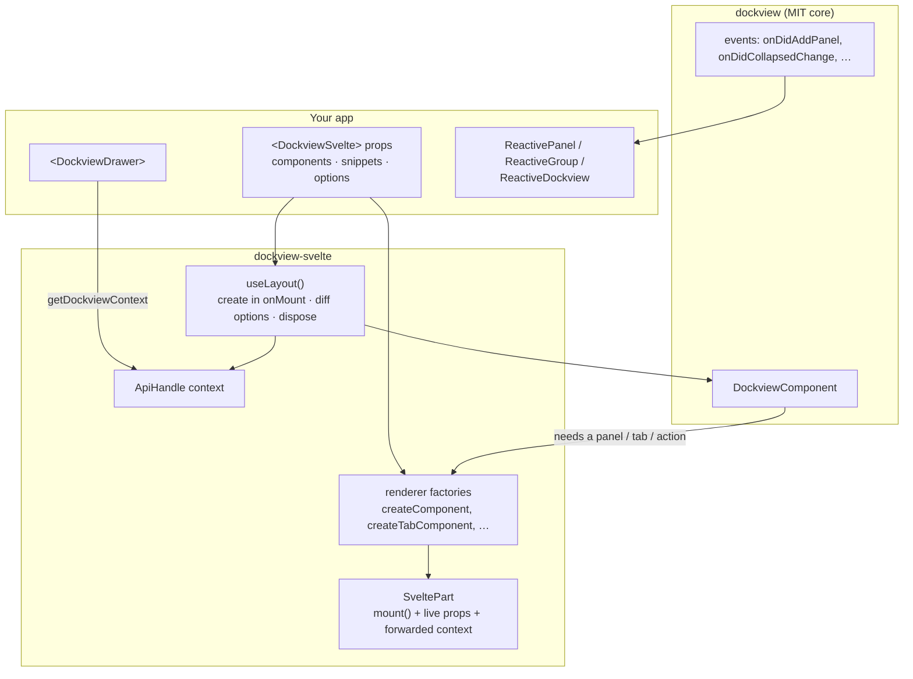

# dockview-svelte

Svelte 5 bindings for [dockview](https://dockview.dev): IDE-style layouts with tabs, splits, drag and drop, floating and popout windows, and **collapsible side drawers with vertical tabs**.

It is a port of the official `dockview-react` wrapper to Svelte's own idioms (runes, snippets, context, `mount`). It also adds a reactive layer and a declarative drawer component that the React package doesn't have. All of it is built on the MIT-licensed core (`dockview`); nothing here uses `dockview-enterprise`.

```svelte
<script lang="ts">
  import { DockviewSvelte, DockviewDrawer, themeAbyss, type DockviewReadyEvent } from 'dockview-svelte';
  import Editor from './Editor.svelte';
  import Files from './Files.svelte';

  function onready({ api }: DockviewReadyEvent) {
    api.addPanel({ id: 'main', component: 'editor', title: 'main.ts' });
  }
</script>

<DockviewSvelte components={{ editor: Editor, files: Files }} {onready} theme={themeAbyss}>
  {#snippet watermark()}<p>Open a file to start</p>{/snippet}

  <DockviewDrawer side="left" size={260} panels={[{ id: 'files', component: 'files', title: 'Files' }]} />
</DockviewSvelte>
```

## Contents

- [Install](#install)
- [Architecture](#architecture)
- [Components](#components)
- [Renderers: components or snippets](#renderers-components-or-snippets)
- [Drawers](#drawers)
- [Reactive state](#reactive-state)
- [Context](#context)
- [Recipes](#recipes)
- [Coming from dockview-react](#coming-from-dockview-react)
- [Development](#development)

## Install

Requires Svelte ≥ 5.30. The package depends on `dockview` (the MIT core) and re-exports its whole API, so apps import everything from `dockview-svelte`.

```bash
npm install dockview-svelte
```

It isn't published to npm yet. To use it from a sibling checkout, link it:

```bash
npm install ../dockview-svelte     # adds "dockview-svelte": "file:../dockview-svelte"
```

…and see [Using a local checkout in an app](#using-a-local-checkout-in-an-app) for the Vite settings this needs.

The dockview stylesheet is imported by the components themselves; there's no separate CSS import. To use popout windows, serve a blank `popout.html` (default URL `/popout.html`; see `static/popout.html` in this repo).

## Architecture

dockview's core is framework-agnostic: it owns the layout tree, the DOM of groups and tabs, drag and drop, serialization, and so on. A framework binding only has to answer one question: *"dockview created an element for a panel, tab or header action; render something into it."* Everything below is about answering that the Svelte way.



The pieces, and the React mechanism each one replaces:

| Concern | dockview-react | dockview-svelte |
|---|---|---|
| Rendering into dockview's elements | `ReactDOM.createPortal` into each element, plus a portal store rendered by the root component | `mount()` straight into the element (`SveltePart`), so there's nothing to collect or render |
| Updating a mounted part's props | A bridge component with a forced `useState` re-render | Props are a live view over a `$state.raw` field; `update()` replaces it, and only readers of changed props re-run |
| Context inside panels | Inherited automatically through portals | `getAllContexts()` is captured once and passed to every `mount()` |
| Instance lifecycle | `useEffect` with StrictMode and `<Activity>` workarounds (`useKeptInstance`) | `onMount` + teardown, wrapped once in `useLayout()` (a rune-based function) |
| Option changes | One `useEffect` per prop, comparing against previous props | One `$effect` that reads the core option keys and sends the diff to `updateOptions` |
| Renderer changes (`components`, …) | Re-registers factories on every change | Factories read the current prop when called (props are live), so only adding or removing an optional renderer needs `updateOptions` |
| Event subscriptions in components (`useTitle`, …) | `useState` + `useEffect` per value | `createSubscriber`: subscribed only while something reads, and disposed automatically |

Some consequences worth knowing:

- **Parts survive moves.** dockview moves the part's element between groups, into floating overlays and into popout windows; the mounted component goes with it and keeps its state. Svelte's delegated events are attached to the mount target, which moves too.
- **Parts mount untracked.** dockview often creates parts while your code is inside an effect (an `addPanel` call in `$effect`). Mounting in `untrack` keeps that effect from depending on whatever the new panel reads.
- **Resizes don't re-render props.** dockview re-sends unchanged params on every layout pass; `SveltePart.update` drops updates that change nothing.
- **SSR-safe.** Nothing touches the DOM before `onMount`; the demo site is prerendered to prove it.

Source layout:

```
src/lib/
  core/        SveltePart, Renderable, useLayout, context, option diffing
  dockview/    DockviewSvelte, DockviewDefaultTab, renderer classes, types
  drawers/     DockviewDrawer
  reactive/    ReactivePanel, ReactiveGroup, ReactiveDockview, eventSubscriber
  gridview/    GridviewSvelte + the grid/split/pane panel views
  splitview/   SplitviewSvelte
  paneview/    PaneviewSvelte
src/routes/    demo site (also the browser test bed)
src/test/      unit tests (vitest + jsdom)
```

## Components

| Component | Wraps | Use for |
|---|---|---|
| `DockviewSvelte` | `createDockview` | Full docking layouts: tabs, groups, floating, popout, drawers |
| `DockviewDrawer` | edge groups | Side drawers inside a `DockviewSvelte` |
| `DockviewDefaultTab` | default tab | Building blocks for custom tabs |
| `GridviewSvelte` | `createGridview` | Grids of resizable panels without tabs |
| `SplitviewSvelte` | `createSplitview` | One row or column of resizable panels |
| `PaneviewSvelte` | `createPaneview` | Collapsible stacked panes (accordion) |

All of them share these props:

- every **core option** of the underlying component (`theme`, `disableFloatingGroups`, `orientation`, …). Changing one calls `updateOptions` with just that key;
- `components`, a record of name → Svelte component;
- `panel`, a snippet for names not found in `components`;
- `api`, which is **bindable** (`bind:api`) and set once the layout exists;
- `onready({ api })`, called once the layout exists. This is the place to `fromJSON` or add the first panels;
- `class` and `style`, applied to the host element. Every component fills its parent (`100%` × `100%`), so give the parent a size.

`DockviewSvelte` also accepts `ondiddrop` and `onwilldrop`, plus the renderer props below. `PaneviewSvelte` adds `headerComponents` / `header` and `ondiddrop`.

Panel components receive the same props as in React:

```svelte
<script lang="ts">
  import type { IDockviewPanelProps } from 'dockview-svelte';
  let { params, api, containerApi }: IDockviewPanelProps<{ path: string }> = $props();
</script>
```

`params` is reactive: `api.updateParameters({ ... })` updates the prop in place, without remounting.

## Renderers: components or snippets

Every renderer has two forms: a component prop named like dockview-react's (`xComponent`), and a snippet prop (`x`). A snippet can be written inline as a child of the component. When both are set, the component wins.

| Renderer | Component prop | Snippet prop | Receives |
|---|---|---|---|
| Panel content | `components[name]` | `panel` (any unknown name) | `IDockviewPanelProps` (+ `name` for the snippet) |
| Tab | `tabComponents[name]` | `tab` (any unknown name) | `IDockviewPanelHeaderProps` (+ `name`) |
| Default tab | `defaultTabComponent` | `defaultTab` | `IDockviewPanelHeaderProps` |
| Empty-layout watermark | `watermarkComponent` | `watermark` | `IWatermarkPanelProps` |
| Group header actions | `right/left/prefixHeaderActionsComponent` | `right/left/prefixHeaderActions` | `IDockviewHeaderActionsProps` (live) |
| Tab group chip | `tabGroupChipComponent` | `tabGroupChip` | `{ tabGroup, api }` |
| Group drag ghost | `groupDragGhostComponent` | `groupDragGhost` | `{ group, api }` |
| Context menu item | `component` in a `getTabContextMenuItems` entry | — | `IContextMenuItemComponentProps` |

```svelte
<DockviewSvelte {components}>
  {#snippet rightHeaderActions({ api, panels, location })}
    {#if location?.type === 'grid'}
      <button onclick={() => api.maximize()}>⛶ {panels.length}</button>
    {/if}
  {/snippet}
</DockviewSvelte>
```

Header actions receive `panels`, `activePanel`, `isGroupActive`, `location` and `headerPosition`, and these are kept up to date as the group changes. Snippets can close over the page's own state, so a header action can read, for instance, a `ReactiveDockview` created by the page.

Components for these props are typed `PartComponent<Props>`. That accepts any component, including ones without props, but type your component's own props as `Props` to get checking inside it.

## Drawers

`DockviewDrawer` turns one of dockview's **edge groups** into a side drawer:

- Tabs run vertically along the drawer's outer edge.
- Clicking the selected tab minimizes the drawer to its tab strip; clicking any tab while minimized opens it again.
- Panels drag in and out of the drawer like any other group, and an emptied drawer collapses to its strip.
- The drawer's size and collapsed state are part of `toJSON()` / `fromJSON()`.

```svelte
<script lang="ts">
  let filesCollapsed = $state(false);
</script>

<DockviewSvelte {components} {onready}>
  <DockviewDrawer
    side="left"
    size={260}
    bind:collapsed={filesCollapsed}
    panels={[
      { id: 'files', component: 'files', title: 'Files' },
      { id: 'search', component: 'search', title: 'Search', inactive: true }
    ]}
  />
  <DockviewDrawer side="right" size={320} collapsed panels={[{ id: 'props', component: 'inspector', title: 'Inspector' }]} />
</DockviewSvelte>

<button onclick={() => (filesCollapsed = !filesCollapsed)}>Toggle files</button>
```

| Prop | Default | |
|---|---|---|
| `side` | — | `'left' \| 'right' \| 'top' \| 'bottom'` |
| `size` | `280` | Initial width (left/right) or height (top/bottom) |
| `minimumSize`, `maximumSize` | — | Size limits while open |
| `collapsedSize` | measured | Size of the minimized strip |
| `collapsed` | `false` | Bindable; also follows tab clicks |
| `group` | — | Bindable, read-only: the underlying `DockviewGroupPanel` |
| `panels` | `[]` | Added when the drawer is created, but **not** when it comes from a restored layout, so a panel the user closed stays closed |
| `removeOnDestroy` | `true` | Remove the edge group when the component is destroyed |
| `id` | `drawer-<side>` | Group id |

Instance methods (via `bind:this`): `toggle()` and `addPanel(options)`, which adds a panel to the drawer and opens it.

When the layout is restored with `fromJSON`, the drawer adopts the restored edge group (including its collapsed state, which flows back into `bind:collapsed`) instead of creating a new one.

## Reactive state

The core api is imperative and event-based. Three small classes expose it as Svelte reactive state. They subscribe only while something reads them, so there's nothing to dispose.

```svelte
<script lang="ts">
  import { ReactivePanel, type IDockviewPanelProps } from 'dockview-svelte';
  let { api }: IDockviewPanelProps = $props();
  const panel = $derived(new ReactivePanel(api));
</script>

<h2>{panel.title}</h2>
{#if panel.isActive}<span>active</span>{/if}
<small>{panel.width} × {panel.height}, in a {panel.location.type} group</small>
```

| Class | Built from | Reactive getters |
|---|---|---|
| `ReactivePanel` | a panel's `api`, or the panel itself | `title`, `isActive`, `isGroupActive`, `isVisible`, `isFocused`, `isPinned`, `width`, `height`, `group`, `location`, `params` |
| `ReactiveGroup` | a `DockviewGroupPanel` | `panels`, `activePanel`, `isActive`, `location`, `isCollapsed`, `headerPosition`, plus `collapse()` / `expand()` / `toggle()` |
| `ReactiveDockview` | a `DockviewApi` | `panels`, `groups`, `activePanel`, `activeGroup`, `hasMaximizedGroup`, `layout`, `has(id)` |

`ReactiveDockview.layout` is the serialized layout. It is recomputed on every layout change, **including drawer collapses**, which the core's own `onDidLayoutChange` doesn't report. Use it for persistence:

```ts
const dock = $derived(api ? new ReactiveDockview(api) : undefined);

$effect(() => {
  if (dock) localStorage.setItem('layout', JSON.stringify(dock.layout));
});
```

`ReactivePanel.params` needs the panel object for its initial value, because the core's `api.getParameters()` stays empty until the first `updateParameters()`. Inside panel components, use the `params` prop instead.

`eventSubscriber([...])` is exported too, for building your own reactive views over dockview events.

## Context

Every part (panel, tab, header action, watermark…) is mounted with the contexts of its `DockviewSvelte`, so `getContext()` inside a panel sees what the page or its ancestors set, just like React portals inherit context.

The component also provides its own handle:

```ts
import { getDockviewContext } from 'dockview-svelte';

const dock = getDockviewContext();   // works in panels and in <DockviewSvelte>'s children
$effect(() => {
  dock.current?.addPanel({ id: 'x', component: 'note' });
});
```

`dock.current` is `undefined` until the layout exists (it is created in `onMount`), so read it in an effect or template.

## Recipes

**Save and restore the layout**

```ts
function onready({ api }: DockviewReadyEvent) {
  const saved = localStorage.getItem('layout');
  if (saved) api.fromJSON(JSON.parse(saved));
  else api.addPanel({ id: 'main', component: 'editor' });
}
```

Drawers re-attach to restored edge groups automatically (see [Drawers](#drawers)).

**Theme switching.** `theme` is an ordinary option prop:

```svelte
<DockviewSvelte theme={dark ? themeAbyss : themeLight} … />
```

**Popout windows.** A popped-out panel's element moves to the new window and keeps working. Stylesheets are copied over by dockview, but CSS variables set on an ancestor in the main window don't come along. Set theme tokens on the panel's own root element (or on `.dv-svelte-part`).

**Wide content in drawers.** The library sets `min-width: 0` on the content of groups whose tabs are on the left or right. Without it, a wide panel in a drawer would overflow sideways over its neighbours.

## Coming from dockview-react

| dockview-react | dockview-svelte |
|---|---|
| `<DockviewReact components onReady />` | `<DockviewSvelte components onready />` |
| `onDidDrop` / `onWillDrop` props | `ondiddrop` / `onwilldrop` |
| `watermarkComponent={W}` | the same, or `{#snippet watermark()}…{/snippet}` |
| `ref` to the host element | `class` / `style` props; `bind:api` for the api |
| `useTitle(api)`-style hooks | `new ReactivePanel(api).title` |
| `GridviewReact`, `SplitviewReact`, `PaneviewReact` | `GridviewSvelte`, `SplitviewSvelte`, `PaneviewSvelte` |
| `PanelParameters`, `IGridviewPanelProps`, … | same names |

The components are named `*Svelte` (as in `*React` / `*Vue`) because the core already exports classes named `Gridview`, `Splitview` and `Paneview`.

## Development

```bash
npm install
npm run dev            # demo site at http://localhost:5173
npm test               # unit tests (vitest + jsdom)
npm run check          # svelte-check
npm run package        # build the library into dist/ and run publint
npm run build          # demo site (prerendered) + package
```

- **Demo.** The demo (`src/routes`) covers drawers, snippets, header actions, context forwarding, reactive state, persistence and the grid/split/pane layouts. It is also where browser behaviour is verified.
- **Tests.** Unit tests live in `src/test/` rather than next to the code, so `svelte-package` doesn't copy them into `dist/`.
- **`.npmrc`.** It sets `legacy-peer-deps=true`, because npm 10's resolver crashes on vite's optional peer chain. Every peer this repo needs is listed explicitly.

### Using a local checkout in an app

A `file:` dependency is a symlink to this repo, and the app uses its built `dist/`. Run the package build in watch mode while working on both:

```bash
npm run package:watch      # here
```

The app's Vite config needs three things, because the package lives outside the app's root and has its own `node_modules`:

```ts
// vite.config.ts of the app
import { defineConfig, type Plugin } from 'vite';

const DOCKVIEW_SVELTE = '../dockview-svelte'; // relative to the app root

function watchLinkedDockview(): Plugin {
  return {
    name: 'watch-linked-dockview-svelte',
    configureServer(server) {
      // Vite only watches the app, so changes in the linked dist/ would be served
      // from a stale cache. The path must be absolute: Vite matches change events
      // against absolute module paths.
      const parent = server.config.root.split('/').slice(0, -1).join('/');
      server.watcher.add(`${parent}/dockview-svelte/dist`);
    }
  };
}

export default defineConfig({
  plugins: [/* sveltekit(), */ watchLinkedDockview()],
  resolve: { dedupe: ['svelte'] },                          // one Svelte runtime, not two
  server: { fs: { allow: ['.', DOCKVIEW_SVELTE] } }         // let the dev server read it
});
```

[LabCraft](../labcraft) (`apps/web-ui`) is set up this way.

## License

MIT. Parts of the code are adapted from dockview-react (MIT, © 2021 mathuo); see [LICENSE](LICENSE).
